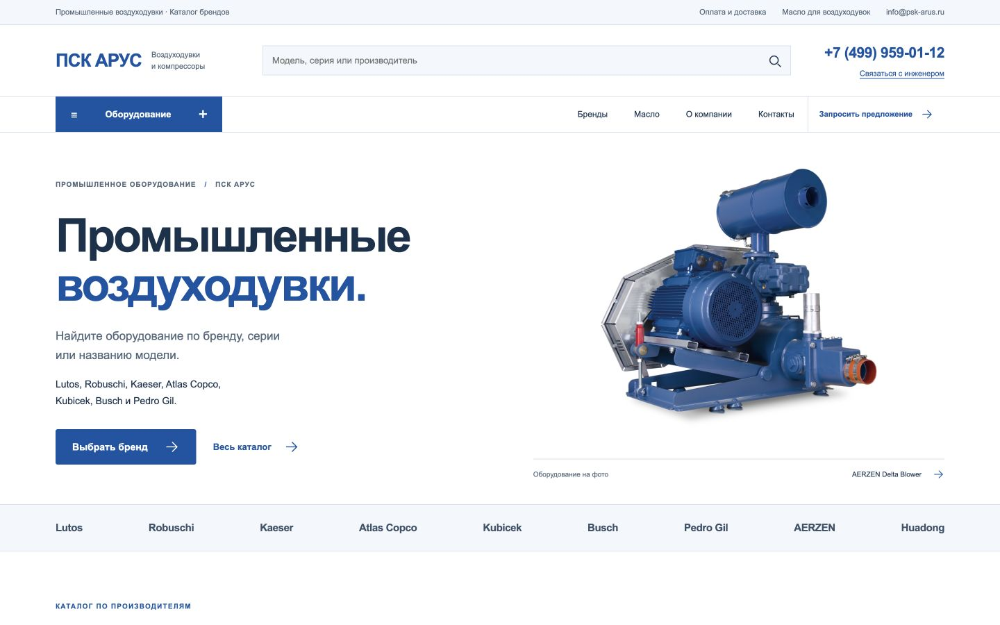

# ПСК АРУС — каталог воздуходувок

[Открыть сайт для просмотра](https://wm669vjvr2-ui.github.io/aerzen-reference-landing/)



Изменение 16.10.2026: сине-белая палитра, фото воздуходувки вместо цеха с кранами, каталог по брендам Lutos, Robuschi, Kaeser, Atlas Copco, Kubicek, Busch, Pedro Gil, AERZEN и Huadong. Блог, пневмотранспорт, расчёты и сервисные разделы удалены из опубликованной версии. Масло выделено в `/oil`. Фирменный PNG пока не получен: в шапке используется нейтральное текстовое название компании.

27 страниц, 30 карточек: 12 серий семи новых брендов с собственными фотографиями серий, 11 моделей Huadong и 7 позиций AERZEN. Общие изображения серий подписаны; уникальные фотографии каждого типоразмера не заявляются. Официальное написание Robuschi, вариант Robushi поддержан в поиске. Историческая серия Lutos DT объяснена по сведениям Atlas Copco, без обещания новых поставок.

Статическая демоверсия открывается без входа, с фотографиями, каталогом, поиском и фильтрами. Формы, заказы, аналитика и индексация поисковиками отключены. Python/FastAPI/Jinja2/SQLite проект сохранён; GitHub Pages показывает подготовленную Python-экспортом копию без серверного кода, базы и секретов.

**Доступ к исходникам:** 16.10.2026 пользователь прямо поручил открыть этот репозиторий для просмотра другими людьми. Поэтому он остаётся `public`; прежнее требование private для него было явно переопределено. Старые документы о private относятся к прежнему состоянию. Исходный репозиторий `aerzen-psk-arus` не изменяется. Рабочая ветка этого отдельного проекта — `codex/reference-landing`, публикация — `gh-pages`.

## Запуск Python

Python 3.12 или новее:

```bash
python3.12 -m venv .venv
.venv/bin/python -m pip install -r requirements-dev.txt
AERZEN_SECURE_COOKIES=false AERZEN_PREVIEW_MODE=true AERZEN_BASE_URL=http://127.0.0.1:8027 .venv/bin/python -m uvicorn app.main:app --host 127.0.0.1 --port 8027 --no-access-log
```

Данные хранятся вне публичной статики: `~/.local/share/aerzen-reference-landing`. Для проверки в этой сессии использован уже установленный соседний Python runtime в режиме чтения; его файлы и зависимости не менялись.

## Публичная копия

```bash
.venv/bin/python scripts/export_preview.py --output /absolute/empty/directory --site-url https://wm669vjvr2-ui.github.io/aerzen-reference-landing
```

Экспортируются только разрешённые HTML-страницы и используемые ими CSS/JS/изображения. Новую сборку следует целиком заменять в ветке `gh-pages`, чтобы не сохранялись исключённые страницы. Backend и SQLite не размещаются на GitHub Pages. До бизнес-запуска нужны согласованные данные владельца, обработка и доставка обращений, права на изображения и совместимый Python хостинг с постоянным приватным хранилищем.

## Источники и проверки

- Текущая сдача: [docs/brands-blue-white-update.md](docs/brands-blue-white-update.md).
- Официальные факты/серии: [docs/brand-research-2026-10-16.md](docs/brand-research-2026-10-16.md).
- Фотографии/SHA256/права: [docs/brand-photo-manifest-2026-10-16.json](docs/brand-photo-manifest-2026-10-16.json).
- UI Pattern Forge, Refero/21st и лицензии компонентов: [docs/home-blue-white-review.md](docs/home-blue-white-review.md). Новые компоненты написаны в проекте без внешней библиотеки.

Числовые цены, наличие и статус официального дилера не подтверждены. Выдуманная скидка 30% не публикуется. Названия сторонних производителей не становятся коммерческими SKU, заказами или предложениями фида. Коммерческие разрешения на перепубликацию фотографий производителей не установлены; публичный просмотр не подтверждает такие права.

```bash
.venv/bin/python -m pytest -q
.venv/bin/python -m compileall -q app scripts tests
git diff --check
```

Исторические отчёты в `docs/` фиксируют предыдущие версии и не заменяют текущий отчёт.
